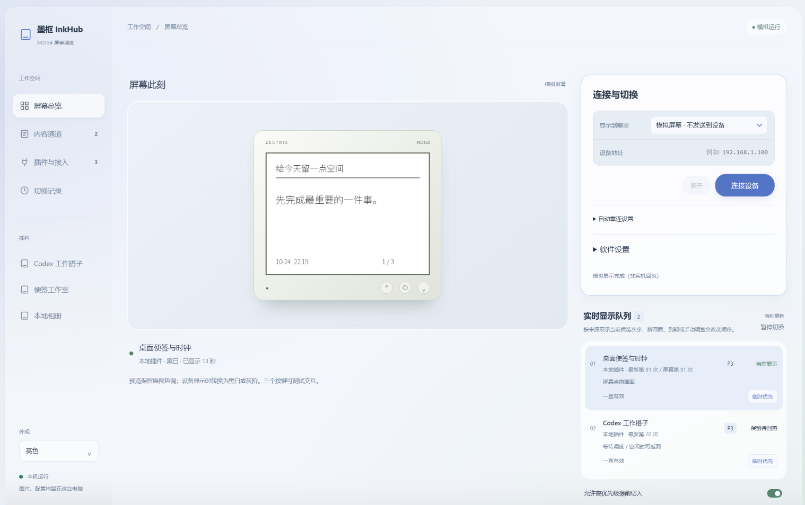
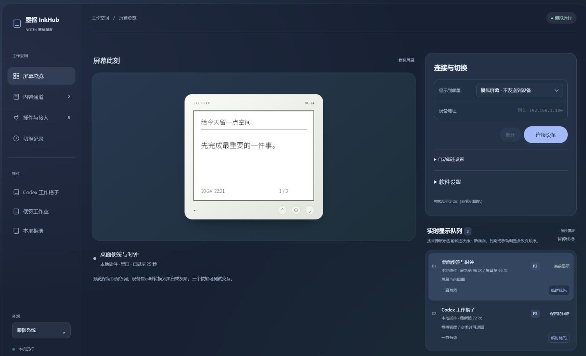
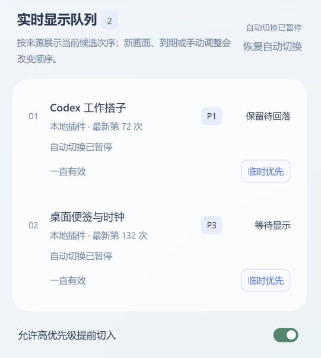
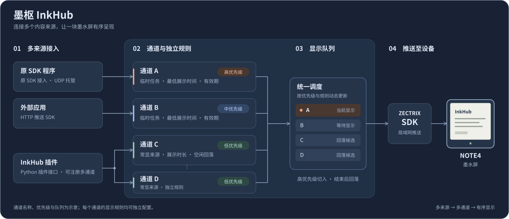
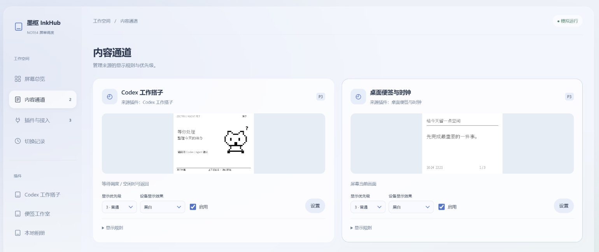
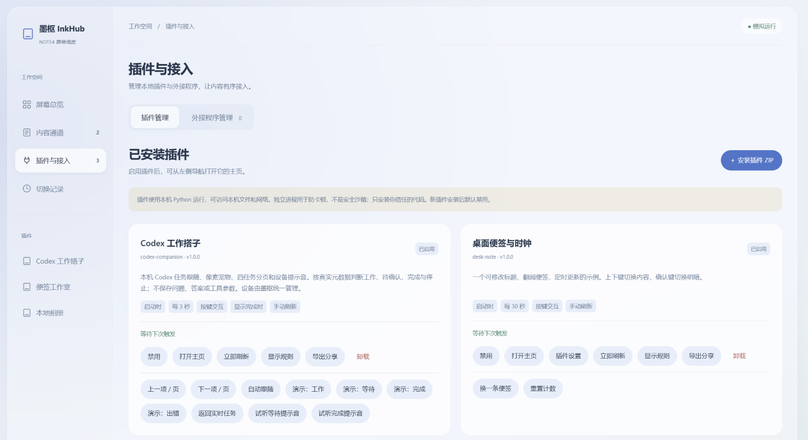
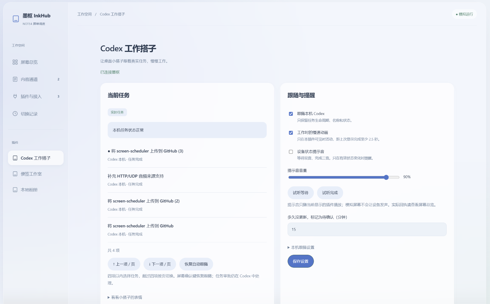

# 墨枢 InkHub

墨枢（InkHub）是基于 ZECTRIX NOTE4 设备局域网推送功能开发的一款多来源管理与调度工具。





## 它是为了解决什么

想要充分利用这块墨水屏设备，比如：

- 有 Codex 任务的情况下展示 Codex 任务，任务停止之后返回到展示今日天气；
- 特别紧急的时候把一段文字临时 Pin 在屏幕上，把文字删掉后，又自动回到在 Codex 任务和天气之间切换的状态。


<p>
  
</p>

*实时内容队列展示*

## 它做了什么



允许用户通过多种方式把自己的原有 ZECTRIX NOTE4 插件接入墨枢统一管理，为每个来源设置不同的优先级，并可以定义每个源是临时任务还是需要常显的任务，从而组出自己想要的任务队列。例如，可以让高优先级任务能够打断低优先级任务显示，当高优先级任务结束之后，还可以回落到低优先级任务。


*内容通道设置页*

简而言之，InkHub 集成了 [zectrix-local-push-sdk](https://github.com/itopinion/zectrix-local-push-sdk)：用户将其他的如天气插件、任务插件的推送路径指向 InkHub，由 InkHub 进行统一管理，以及推送到真机。


*插件管理页*

其中，用户可以通过三种方式接入 InkHub：

1. **原 SDK 直连**：使用 [zectrix-local-push-sdk](https://github.com/itopinion/zectrix-local-push-sdk) 接入。对于已经集成 [该 SDK](https://github.com/itopinion/zectrix-local-push-sdk) 的项目，把 IP 和端口指向 InkHub 即可，这种方式对于已有项目几乎完全不需要进行代码修改。
2. **集成 HTTP 推送 SDK**：集成本项目自带的 HTTP 推送 SDK。对于已经集成 [zectrix-local-push-sdk](https://github.com/itopinion/zectrix-local-push-sdk) 的项目，也仅需进行少量修改即可额外集成。
3. **编写 InkHub 插件**：对于尚未集成 [zectrix-local-push-sdk](https://github.com/itopinion/zectrix-local-push-sdk)、尚处于概念状态的想法，您可以考虑编写一个符合 InkHub 规范的轻量 Python 插件直接接入 InkHub，该方式可以额外获得：注册多个内容通道的能力；将设置页集成进入InkHub便于统一操作的能力。

快速入门编写插件， 可阅读[plugin-development](https://github.com/strincake/screen-scheduler/blob/main/docs/guides/plugin-development.md)，或将该链接传递给AI。


*插件内嵌设置页*

项目目前内置了三个插件，你可以按需启用和卸载：

1. **Codex 工作搭子**：[zectrix-agent-pet](https://github.com/itopinion/zectrix-agent-pet) 的 InkHub 插件重写版本，仅复刻功能，未使用原有代码。
2. **本地文件夹相册轮播**：支持选取多个文件夹，并将每个文件夹作为单独通道管理。
3. **桌面便签与时钟**：一个简易的示例便签程序。

## 怎么使用

该项目目前仅编译了 Windows 端，你可以通过 [GitHub Releases](https://github.com/strincake/screen-scheduler/releases) 进行下载；程序运行后会在托盘驻留，并使用浏览器网页作为前端展示。
其他平台如想使用需自行编译，请参考后续的章节。

## 当前局限

- 部分功能如原生 SDK 接入、HTTP SDK 接入和声音透传，未经过充分的真机测试，可能存在一定问题。
- 由于目前功能较为庞杂，有任何想法和问题，欢迎提 issues。

## 后续规划

- 补充基于时间段的多通道配置组管理。


# 详细功能与构建介绍

## 主要功能

- **屏幕调度**：为每个通道来源可以设置：五级优先级、最低展示时间、任务有效期、临时优先、长期来源空闲回落，以及展示实时调度队列。
- **设备管理**：每个通道支持单独设置黑白、四灰、十六灰输出，并针对每个来源单独进行设备显示回执，按键回传。
- **插件中心**：通过 ZIP 安装、启用、配置和卸载本地插件；插件可提供独立主页，并按需要使用宿主设置表单。
- **本地相册**：一个插件管理多个文件夹来源，支持固定图片、顺序/随机轮播、留边/裁剪及屏幕按键翻图。
- **Codex 工作搭子**：跟随本机任务状态，显示像素角色、任务分页和可选提示音；其他 Agent 可通过本机文件上报状态。
- **支持外部程序接入**：HTTP v1 与原 SDK 的 UDP 托管入口，支持绑定画面的最长 3 秒提示音，附 Rust / Python HTTP 客户端和示例。

## Windows 安装版

正式发布时通过 GitHub Release 提供安装包（私有仓库需要读取权限）；当前本机生成结果在 `dist/releases/`。安装版自带 Python、Pillow 与中文字体，普通用户无需编译或配置开发环境。

启动后驻留右下角托盘，可查看运行状态、打开管理界面或正常退出。关闭网页后仍继续运行。首次已安装三个插件，全部默认禁用。

“连接与切换 → 软件设置”提供**随 Windows 启动**开关，默认关闭；开启后登录 Windows 时仅驻留托盘，不自动弹出网页。设置与插件数据保存在 `%LOCALAPPDATA%/InkHub/`，升级或卸载时保留。

构建安装包使用 `./scripts/package-windows.ps1`，详见[Windows 安装与发布](docs/development/windows-release-plan.md)。以下环境准备面向源码开发者。

## 环境准备

当前启动脚本面向 Windows。开发环境需要：

| 工具 | 用途 |
| --- | --- |
| Rust stable，MSVC 工具链 | 构建 Rust 宿主和客户端 |
| Visual Studio C++ Build Tools、Windows SDK | 编译和链接 Windows 原生依赖 |
| CMake | 构建设备 SDK 的 Opus 原生依赖 |
| Python 3.10+ 与 Pillow | 插件运行、图片处理、插件打包和 Python 测试 |
| Node.js 与 Playwright（可选） | 浏览器界面回归测试 |

请在能找到 `cargo`、C++ 编译器和 `cmake` 的终端中构建。Python 必须能以 `python` 命令启动；宿主会调用这个命令运行插件。

在项目根目录安装 Python 依赖：

```powershell
python -m pip install -r requirements.txt
```

Pillow 版本固定为本次整理时使用的版本；Rust 的依赖版本由根目录 `Cargo.lock` 固定。首次构建需要获取依赖，具备完整缓存后才可使用 Cargo 的 `--offline` 选项。

## 构建与启动

在项目根目录执行：

```powershell
./build.ps1
./start.ps1
```

也可以一次完成构建和启动：

```powershell
./start.ps1 -Build
```

正式优化构建使用 `./build.ps1 -Release`，随后运行 `./start.ps1 -Release`。脚本将构建产物统一放在本项目的 `target/` 下。Release 构建会自动将三个内置插件打包并嵌入 EXE；首次启动自动安装缺失的内置插件，全部默认禁用，不执行插件代码。已有同 ID 插件不会覆盖，后续禁用或卸载也不会被重启撤销。开发构建保持原有的手动安装方式。

打开管理界面：[127.0.0.1:38476](http://127.0.0.1:38476)。网页关闭后服务仍会运行；在侧栏点击“退出墨枢”才能正常释放设备并结束服务。已有旧实例时，请先从旧网页退出，再启动本目录中的实例。

需要直接运行或指定其他数据位置时：

```powershell
./target/debug/note4-screen-scheduler.exe --config ./settings.json
```

`--config` 指向设置文件；插件运行目录根据它生成，例如 `settings.json` 对应同目录下的 `settings.plugins/`。源码运行方式仍使用项目目录；安装版从自身目录定位 Python worker 和运行环境。分发时请使用完整安装包或便携 ZIP，不单独复制开发目录中的 EXE。

启动脚本也支持 `-Config`、`-Port`、`-HttpBind` 和 `-SdkBind`，可为独立实例指定数据文件和端口。

## 第一次使用

1. 启动后先在模拟屏幕中检查队列和画面。
2. Release 版本已自动准备三个内置插件，可直接在插件中心按需启用。
3. 开发构建或需要单独分享插件时，运行 `./pack-plugins.ps1`，再从插件中心安装 `dist/plugins/` 中的 ZIP；手动安装也默认禁用。
4. 本地相册从左侧插件主页添加文件夹来源；便签与 Codex 工作搭子也通过各自主页操作。
5. 需要使用实体 NOTE4 时，先退出其他占用设备的程序，在“我的 NOTE4”中填写设备地址并主动连接。
6. 对每个内容来源设置优先级和显示规则。

## 接口和端口

| 接口 | 默认地址 | 用途 |
| --- | --- | --- |
| 管理网页与 `/control/*` | `127.0.0.1:38476` | 本机管理 |
| HTTP v1 | `127.0.0.1:38477` | 外部程序注册、交图、回执和按键 |
| UDP 托管入口 | `127.0.0.1:32342` | 原 SDK 程序接入 |

服务默认绑定本机地址。HTTP 接入密钥在管理界面获取；管理接口与外部程序接口的认证方式不同。详见[接入协议](docs/guides/protocol.md)和[客户端说明](clients/screen-scheduler-client/README.md)。

## 项目目录

```text
screen-scheduler/
├─ src/                            Rust 宿主、调度、设备与插件管理
├─ web/                            中文管理界面（构建时嵌入宿主）
├─ python/                         Python worker、安装/迁移工具与 plugin_kit API
├─ plugins/                        三个随附插件的源码、主页和说明
│  ├─ desk-note/                   桌面便签与时钟
│  ├─ local-gallery/               本地相册
│  └─ codex-companion/             Codex 工作搭子
├─ clients/screen-scheduler-client/ Rust / Python HTTP 客户端及示例
├─ vendor/zectrix-local-push-sdk/   固定的设备 SDK 源码快照与许可证
├─ tests/                          Rust、Python、浏览器测试及本机模拟器
├─ scripts/                        插件打包等开发工具
├─ docs/                           使用、开发、整理记录和历史设计
├─ build.ps1 / start.ps1            本项目构建与启动
└─ pack-plugins.ps1                随附插件打包
```

`target/` 保存编译产物，`dist/plugins/` 保存可分发插件包，`artifacts/` 保存测试报告、截图和临时数据。它们与本机 `settings.json`、`settings.plugins/` 均由 `.gitignore` 排除。不要把已安装插件的私有数据目录当作插件源码分享。

## SDK 与依赖管理

设备 SDK 来自 [itopinion/zectrix-local-push-sdk](https://github.com/itopinion/zectrix-local-push-sdk)，以源码快照存放于 `vendor/`，宿主和 HTTP 客户端引用同一份快照。项目无需相邻 SDK 文件夹，也无需 Git 子模块初始化。

此快照保留整理时使用的本地版本，包括 Windows UDP 测试模拟器的修补。上游基准提交、文件校验值及差异说明见 [SDK 快照记录](vendor/zectrix-local-push-sdk/SNAPSHOT.json)与[依赖说明](docs/development/dependencies.md)。更新 SDK 时需要整体替换、记录来源并重新验证。

## 开发与验证

```powershell
cargo test --locked --workspace
cargo build --locked --workspace --examples
python -m unittest discover -s tests/unit -p "test_*.py"
./pack-plugins.ps1
python tests/integration/integration.py
python tests/integration/source-integration.py
```

更多集成测试、浏览器检查及各自环境要求见[测试说明](docs/development/testing.md)。本机模拟器验证用于确认软件协议行为，不能代替实体设备测试。各轮检查结果见[整理与验证记录](docs/development/repository-preparation.md)。

Windows 安装、用户数据、自启、打包及草稿 Release 流程见[Windows 发布说明](docs/development/windows-release-plan.md)。

## 当前边界

- Windows 完整包提供系统托盘和可选自启；其他平台安装包尚未验证。当前 Windows 安装包未签名。
- SDK 的 `Busy`、`ResultUnknown` 等失败会暂停发送；用户处理后明确继续，不自动重放未知结果。
- 提示音由插件提交、宿主统一播放，默认关闭；录音内容不保存或上传。HTTP/UDP 外部来源目前支持音频。
- 插件是有本机权限的 Python 代码；网页 iframe 的隔离不能把 Python 插件变成安全沙箱。
- 本地设置以明文保存；Codex 工作搭子启用后会读取配置指定的本机会话元数据。
- SDK 支持的硬件与固件范围见 [SDK README](vendor/zectrix-local-push-sdk/README.md)。

## 文档与许可证

完整入口见[文档索引](docs/README.md)。设备 SDK、Opus 与工作搭子插件的已有许可证和声明均已保留，详见[第三方声明](THIRD_PARTY_NOTICES.md)。主项目采用 [MIT 许可证](LICENSE)，允许使用、修改、分发及商业使用；分发时须保留版权和许可声明。第三方组件遵循各自的许可证。

